


  

 


  <a href="https://github.com/goprocker/sathyabamaexpress">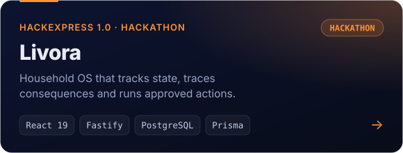</a>
  <a href="https://github.com/goprocker/ResponseSync">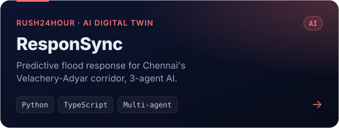</a>
  <a href="https://github.com/goprocker/Digital-Horizon-Conclave-2026">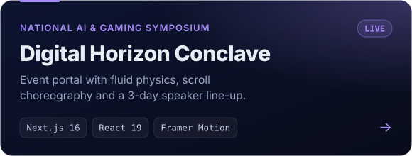</a>
  <a href="https://github.com/LoopFound/loopfoundwebsite">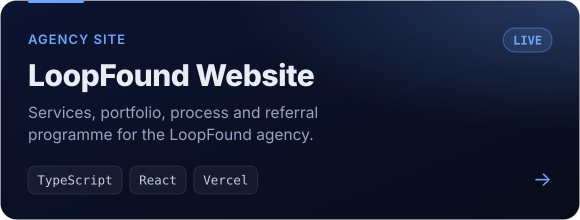</a>
  <a href="https://github.com/goprocker/orivo">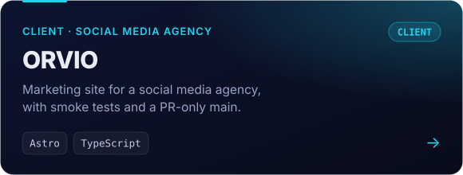</a>
  <a href="https://github.com/goprocker/UNBD">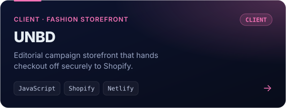</a>

Live: <a href="https://sathyabamaexpress-five.vercel.app">Livora</a> · <a href="https://responsesync.ai.studio/">ResponSync</a> · <a href="https://digital-horizon-conclave-2026.vercel.app">Digital Horizon Conclave</a> · <a href="https://loopfoundwebsite.vercel.app">LoopFound</a>

<a href="https://github.com/LoopFound">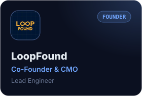</a>
<a href="https://github.com/AI-FOUNDARY-29">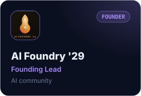</a>
<a href="https://github.com/snycoai">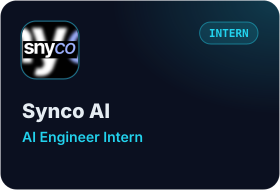</a>
<a href="https://github.com/dscsist">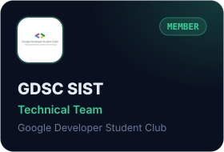</a>
 
<a href="https://github.com/Redrox-Industries">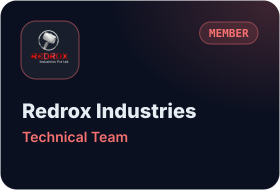</a>
<a href="https://github.com/Rare-Atom">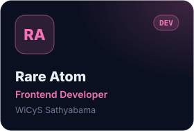</a>
<a href="https://gssoc.girlscript.tech">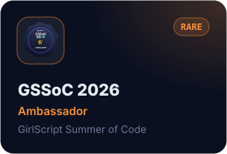</a>



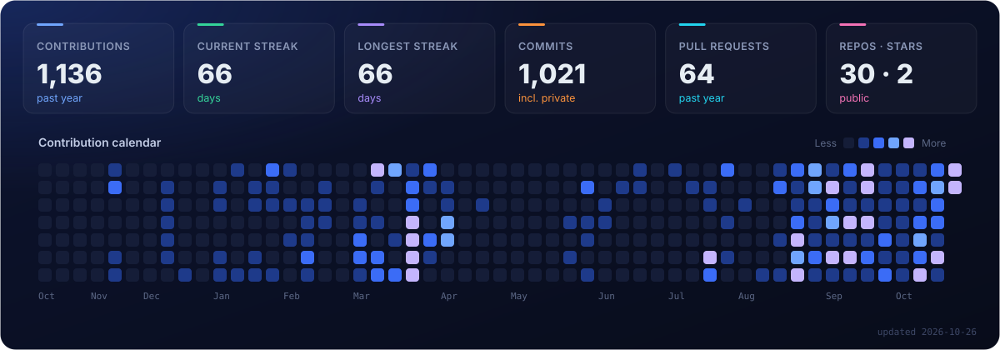

<a href="mailto:gopinath2638@gmail.com">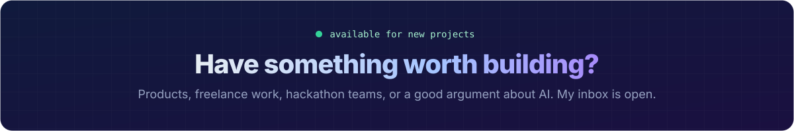</a>

<a href="mailto:gopinath2638@gmail.com">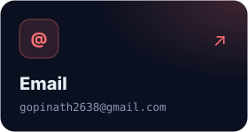</a>
<a href="https://linkedin.com/in/gopinath2638">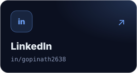</a>
<a href="https://x.com/gopinath2368">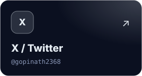</a>
<a href="https://www.instagram.com/goprocker_photography_/?hl=en">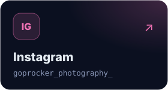</a>
<a href="https://loopfound.in">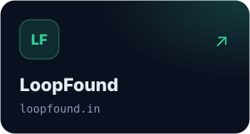</a>

  

