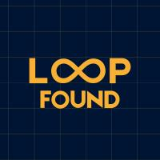
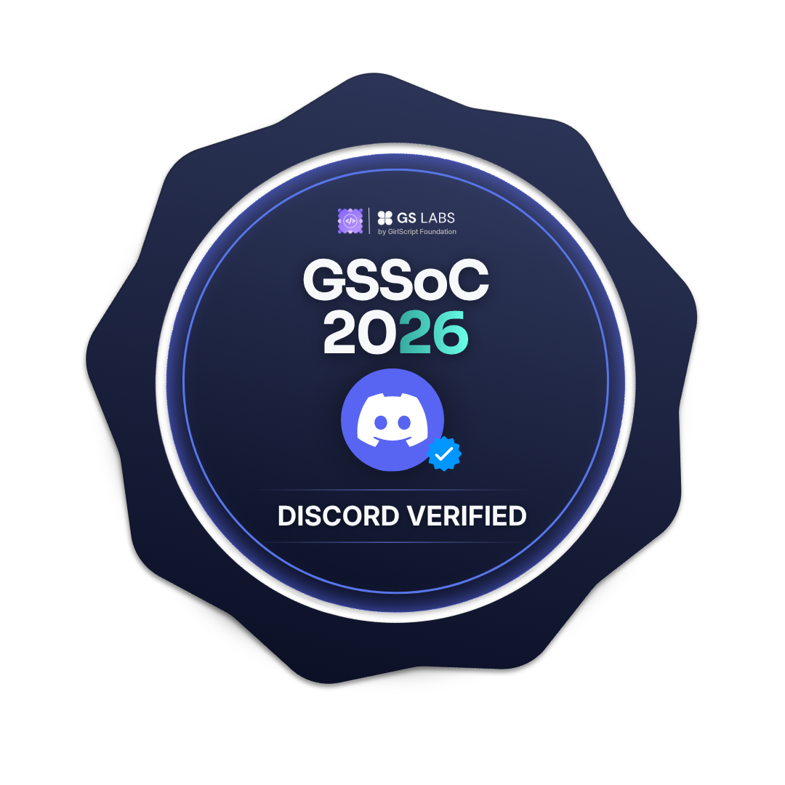
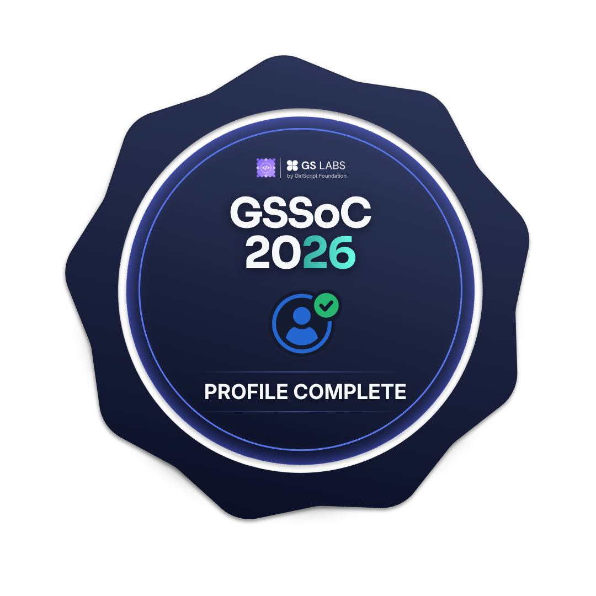

  
  
  
  
  
  

## Hi, I'm Gopinath 👋

CS & AI Engineering student in **Chennai, India**, co-founder of **[LoopFound](https://loopfound.in)**, and a full-stack developer who likes shipping things people actually use.

- 🔭 Building client platforms at **LoopFound** and **P2PSkill**, a peer-to-peer skill exchange
- 🤖 Exploring multi-agent AI systems, LLM tooling and computer vision
- 🏆 GSSoC 2026 Ambassador and regular at hackathons
- 📫 Open to collaborations, freelance work and interesting problems

## 🚀 Featured Work

| Project | What it is | Stack |
| --- | --- | --- |
| **[LoopFound](https://loopfound.in)** | Web agency shipping fast, production-grade sites for real businesses | Next.js · TypeScript · Tailwind · Vercel |
| **QR Attendance** | Campus attendance with sub-second scans and anti-replay tokens. Used by **1,000+** people | Node.js · MongoDB |
| **P2PSkill** | Peer-to-peer skill exchange without monetary barriers | React · Express · MongoDB · Firebase |
| **[ResponseSync](https://github.com/goprocker/ResponseSync)** | AI disaster-response platform with multi-agent coordination, built at Rush24Hour | TypeScript |
| **[Orchestrix](https://github.com/goprocker/Orchestrix)** | Research intelligence platform where an orchestrator routes queries across specialised agents | TypeScript |

## 🏢 Organizations

<table align="center">
<tr>
<td align="center" width="140"> <a href="https://github.com/LoopFound"><b>LoopFound</b></a> Co-Founder &amp; CMO · Lead Engineer</td>
<td align="center" width="140"> <a href="https://github.com/AI-FOUNDARY-29"><b>AI Foundry '29</b></a> Founding Lead</td>
<td align="center" width="140"> <a href="https://github.com/snycoai"><b>Synco AI</b></a> AI Engineer Intern</td>
<td align="center" width="140"> <a href="https://github.com/dscsist"><b>DSC SIST</b></a> Technical Team</td>
</tr>
<tr>
<td align="center" width="140"> <a href="https://github.com/microsoftclubsist"><b>Microsoft Club SIST</b></a> Web &amp; App Developer</td>
<td align="center" width="140"> <a href="https://github.com/Redrox-Industries"><b>Redrox Industries</b></a> Technical Team</td>
<td align="center" width="140"><a href="https://github.com/Rare-Atom"><b>Rare Atom</b></a> Frontend Developer WiCyS Sathyabama</td>
<td></td>
</tr>
</table>

## 🛠 Tech Stack

 

## 🏆 GSSoC 2026

&nbsp;

<b>Ambassador</b> (rare) · plus 6 common badges

## 📊 GitHub Stats

