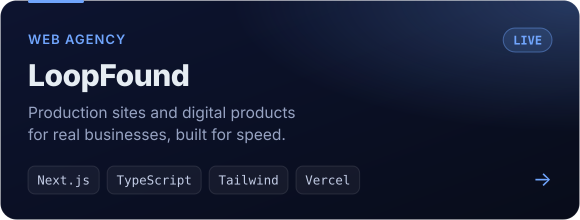
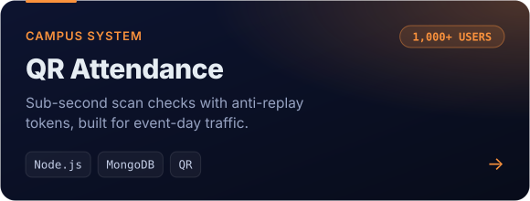
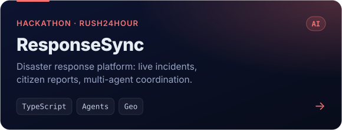
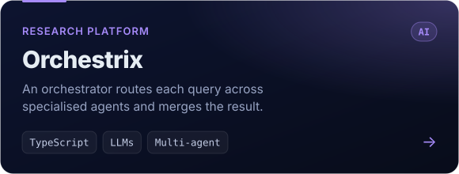
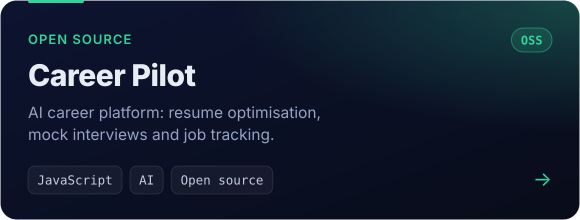
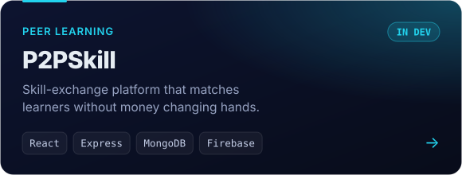

  

 

I'm a **CS & AI Engineering student** from Chennai who'd rather ship than talk about shipping. I co-founded **[LoopFound](https://loopfound.in)**, a web agency building production sites for real businesses. I also build AI tools, mostly multi-agent systems, at hackathons and in open source.

<table>
<tr>
<td width="50%" valign="top">

**🔨 Building**
- Client platforms at **LoopFound**
- **P2PSkill**, a peer-to-peer skill exchange
- AI agent tooling and orchestration

</td>
<td width="50%" valign="top">

**🧠 Learning**
- LLM agents and computer vision
- Scalable backends and system design
- DSA in Java and C++

</td>
</tr>
</table>

  
  
  
  
  
  

Also: <a href="https://github.com/goprocker/Digital-Horizon-Conclave-2026">Digital Horizon Conclave 2026</a> · <a href="https://github.com/goprocker/Parallel_Realities">Parallel Realities</a> · <a href="https://github.com/goprocker/sathyabamaexpress">Sathyabama Express</a> · <a href="https://github.com/goprocker/FitMart">FitMart</a>

<table align="center">
<tr>
<td align="center" width="150"> <a href="https://github.com/LoopFound"><b>LoopFound</b></a> Co-Founder &amp; CMO</td>
<td align="center" width="150"> <a href="https://github.com/AI-FOUNDARY-29"><b>AI Foundry '29</b></a> Founding Lead</td>
<td align="center" width="150"> <a href="https://github.com/snycoai"><b>Synco AI</b></a> AI Engineer Intern</td>
<td align="center" width="150"> <a href="https://github.com/dscsist"><b>GDSC SIST</b></a> Technical Team</td>
</tr>
<tr>
<td align="center" width="150"> <a href="https://github.com/microsoftclubsist"><b>Microsoft Club</b></a> Web &amp; App Dev</td>
<td align="center" width="150"> <a href="https://github.com/Redrox-Industries"><b>Redrox</b></a> Technical Team</td>
<td align="center" width="150"><a href="https://github.com/Rare-Atom"><b>Rare Atom</b></a> Frontend Dev WiCyS Sathyabama</td>
<td align="center" width="150"><a href="https://gssoc.girlscript.tech"><b>GSSoC '26</b></a> Ambassador</td>
</tr>
</table>

  

 
<b>AMBASSADOR</b> · rare badge
  

Got a product to build, a hackathon team to fill, or an idea worth arguing about? 
**[gopinath2638@gmail.com](mailto:gopinath2638@gmail.com)** · **[loopfound.in](https://loopfound.in)**

 

