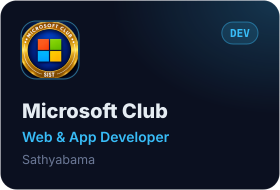

  

 

  
  
  
  
  
  

Live: <a href="https://sathyabamaexpress-five.vercel.app">Livora</a> · <a href="https://responsesync.ai.studio/">ResponSync</a> · <a href="https://digital-horizon-conclave-2026.vercel.app">Digital Horizon Conclave</a> · <a href="https://loopfoundwebsite.vercel.app">LoopFound</a>

 

<table>
<tr>
<td width="160"><b>Languages</b></td>
<td></td>
</tr>
<tr>
<td width="160"><b>Frontend</b></td>
<td> </td>
</tr>
<tr>
<td width="160"><b>Backend &amp; Data</b></td>
<td></td>
</tr>
<tr>
<td width="160"><b>AI &amp; ML</b></td>
<td>    </td>
</tr>
<tr>
<td width="160"><b>Infra &amp; Tools</b></td>
<td> </td>
</tr>
<tr>
<td width="160"><b>Design</b></td>
<td>   </td>
</tr>
</table>

 
<b>AMBASSADOR</b> · rare badge
  

  

